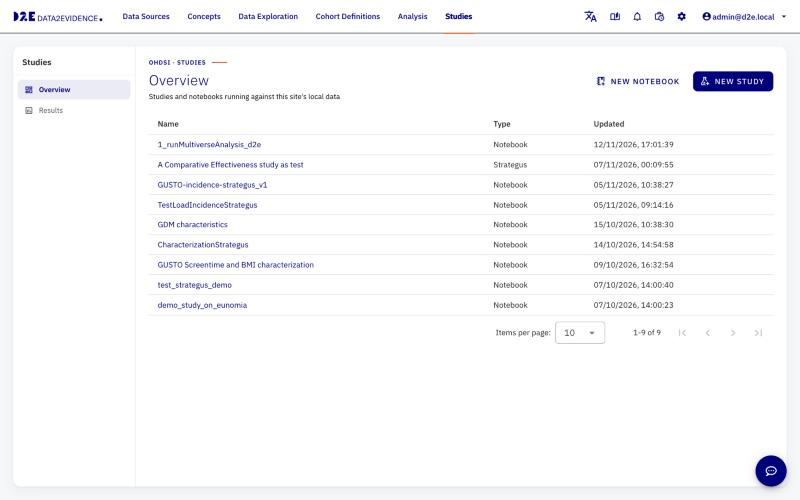
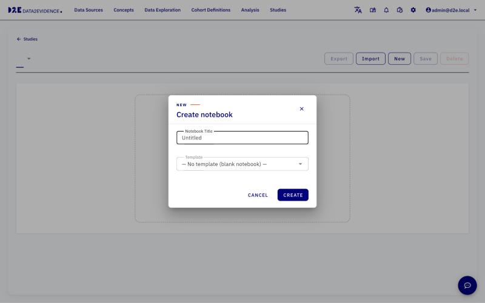
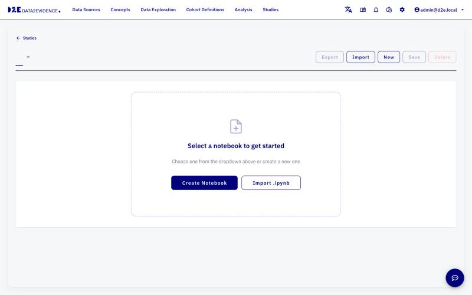
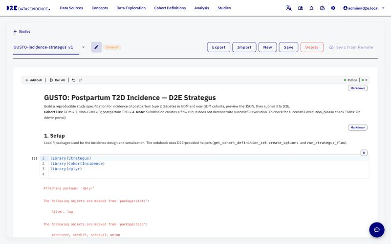
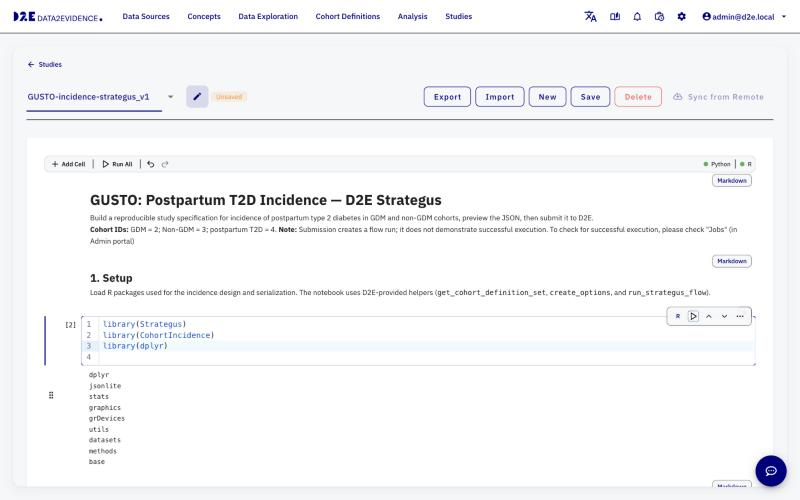
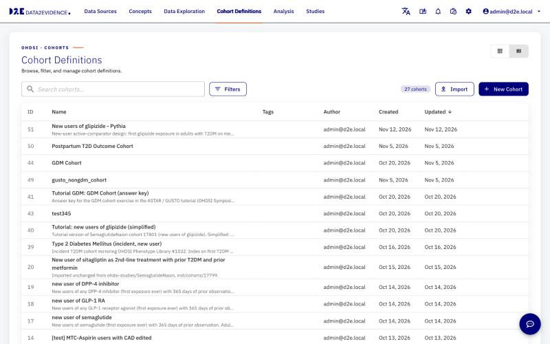
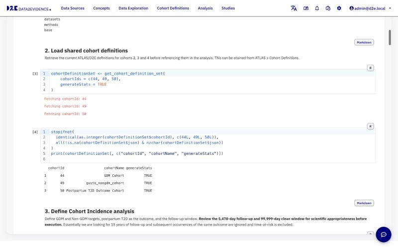
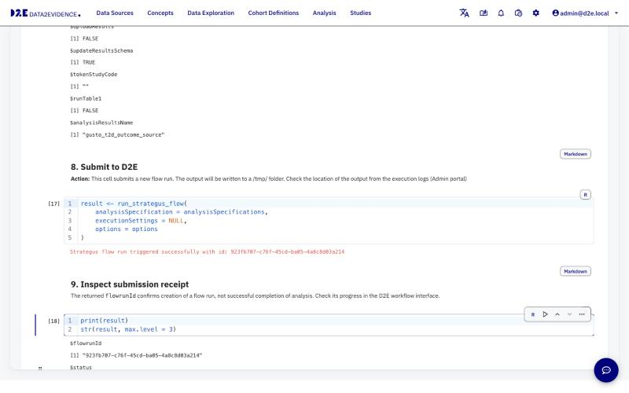

# Notebook onboarding for researchers

Source for the onboarding deck. Regenerate the .pptx with `build_deck.py` (see `README.md`).

Format:
- Each `## ` heading starts one slide. The first slide is the title slide; its `Subtitle:` line is the subtitle.
- `- ` lines are bullets. `` places a screenshot on the right (or full width if the slide has no bullets).
- Fenced code blocks are shown as code. `| ... |` rows become a table. A `::: flow` block draws a left-to-right process.
- `Notes:` starts the speaker notes; everything after it on that slide is notes.
- `[PLACEHOLDER]` and `[TO VERIFY]` are highlighted on the slide. Resolve them before presenting.

Everything on the slides was checked on the test host `internal.d2e.sg` on 2026-11-23, signed in to ATLAS, using the existing notebook "GUSTO-incidence-strategus_v1" (dataset `gusto_v3`). Screenshots in `img/` come from that session.

---

## Designing Strategus studies in the D2E notebook

Subtitle: Researcher onboarding · Data science team

Notes: This session covers finding and creating notebooks, running R, loading cohorts, building a Strategus analysis specification and submitting it to D2E. Reviewing results is a separate follow-up session.

---

## What you'll be able to do

- Find, open and create notebooks in ATLAS
- Write and run R code, and load the packages you need
- Pull your cohort definitions from ATLAS into R
- Build a Strategus analysis specification
- Submit it to D2E as a flow run
- [PLACEHOLDER] Access: notebooks are available on request. Add how to request access and who approves it.

Notes: Access is granted on request; with access you can view, build and run notebooks. Fill in the request process before presenting.

---

## Where notebooks live

- In ATLAS, open **Studies** in the top menu
- **Overview** lists studies and notebooks, with their type and last update
- Click a name to open it
- **New Notebook** creates one
- **Results** in the side menu is covered in the follow-up session



Notes: Screenshot from internal.d2e.sg, ATLAS → Studies → Overview.

---

## Creating a notebook

- Click **New Notebook**
- Enter a **Notebook Title**
- Leave **Template** as "No template (blank notebook)". No templates are published yet.
- Click **Create**



Notes: On the test host the Template list only offers the blank notebook. When templates are published, they will appear in this list.

---

## Opening or importing a notebook

- Pick a notebook from the dropdown at the top left
- **Create Notebook** starts a new one
- **Import .ipynb** loads a Jupyter notebook file from your computer
- **Export** in the header downloads the open notebook as .ipynb



Notes: This is the editor before a notebook is selected.

---

## The editor at a glance

- **Header:** notebook picker, then Export, Import, New, Save, Delete
- **Unsaved** tag: the notebook has changes that are not saved yet
- **Toolbar:** Add Cell, Run All, Undo and Redo
- **R status dot** (top right): green means R is ready
- Cells hold R code or Markdown text



Notes: "Sync from Remote" is greyed out because the Git integration is not set up; skip it. On the current version the Unsaved tag can appear right after opening a notebook, before any edit; a fix is in progress.

---

## Writing and running R cells

- **Add Cell → R Cell** adds a cell, or use **+ R** below the last cell
- **▷** on the cell toolbar runs that cell
- **[n]** shows the order cells were run in
- Only the **last line's value** is shown. Use `print()` to see anything else.
- Red text is not always an error. Progress messages are red too.



Notes: Verified on the host: a cell with three expressions only displayed the last one. The red "Fetching cohortId" lines on a later slide are messages, not errors.

---

## Saving your work

- Click **Save** often. The **Unsaved** tag shows until you do.
- Leaving through the ATLAS top menu does **not** warn you about unsaved changes. Save first.
- After reloading the page, run your cells again from the top. R starts fresh.
- **Run All** runs every cell, including any cell that submits a study. Use it only when you mean to submit.

Notes: Observed on internal.d2e.sg: navigating to Studies from the top menu with the Unsaved tag showing did not ask to save or discard. After a reload the run counters restarted, so earlier results were gone until the cells were run again.

---

## Using R packages

- Load packages with `library()`. Strategus and its modules (CohortIncidence, Characterization, …) are ready to use.
- A missing package is installed for you the first time you load it
- If it isn't available for the notebook, you see *Requested package … not found in webR binary repo.*

```r
library(Strategus)
library(praise)    # not installed yet: the notebook installs it
praise()           # e.g. "You are fantabulous!"

rownames(installed.packages())   # what is installed
```

Notes: Verified on the host: praise was not installed (FALSE), then library(praise) installed and loaded it. library(notARealPackage123) printed "Installing notARealPackage123...", the "not found in webR binary repo" warning, then "there is no package called 'notARealPackage123'". If a package you need is not available, contact the platform team.

---

## Finding your cohort IDs

- Cohorts are defined in ATLAS → **Cohort Definitions**
- The **ID** column is the number you use in the notebook
- This example uses 44 (GDM Cohort), 49 (non-GDM cohort) and 50 (postpartum T2D outcome)



---

## Loading cohorts into the notebook

- `get_cohort_definition_set()` fetches the definitions by ID
- It prints one *Fetching cohortId* line per cohort
- The result is a table with `cohortId`, `cohortName` and the definition

```r
cohortDefinitionSet <- get_cohort_definition_set(
  cohortIds = c(44, 49, 50),
  generateStats = TRUE
)
```



Notes: Run live on the host; output is real.

---

## How a Strategus specification fits together

::: flow
- Cohorts from ATLAS
- Shared resources
- Analysis modules
- Analysis specification
- Submit to D2E
:::

- **Shared resources:** the cohort definitions every module uses
- **Modules:** what to run. Cohort Generator first, then your analysis (Cohort Incidence, Characterization, Cohort Method, …)
- **Analysis specification:** shared resources plus modules, in order
- **Submit:** send the specification and run options to D2E

Notes: The next three slides walk through a real study: incidence of postpartum type 2 diabetes in GDM and non-GDM pregnancies.

---

## Example 1 of 3: define the analysis

```r
targets <- list(
  CohortIncidence::createCohortRef(id = 44, name = "GDM Pregnancy"),
  CohortIncidence::createCohortRef(id = 49, name = "Non-GDM Pregnancy"))
outcomes <- list(
  CohortIncidence::createOutcomeDef(id = 1, name = "Postpartum Type 2 Diabetes",
                                    cohortId = 50, cleanWindow = 99999))
tars <- list(
  CohortIncidence::createTimeAtRiskDef(id = 1, startWith = "start", startOffset = 0,
                                       endWith = "start", endOffset = 5478))
analysis <- CohortIncidence::createIncidenceAnalysis(
  targets = c(44, 49), outcomes = c(1), tars = c(1))
irDesign <- CohortIncidence::createIncidenceDesign(
  targetDefs = targets, outcomeDefs = outcomes, tars = tars,
  analysisList = list(analysis),
  strataSettings = CohortIncidence::createStrataSettings(
    byAge = FALSE, byGender = FALSE, byYear = FALSE))
```

- Targets and the outcome refer to the cohort IDs from ATLAS
- Time at risk: 5,478 days (about 15 years) from cohort start

Notes: Same calls as cells 4–8 of GUSTO-incidence-strategus_v1, with line breaks condensed. Run live on the host.

---

## Example 2 of 3: assemble the specification

```r
ciModule <- Strategus::CohortIncidenceModule$new()
ciSpecs  <- ciModule$createModuleSpecifications(irDesign = irDesign)

cohortResources <- createCohortSharedResourceSpecifications(
  cohortDefinitionSet = cohortDefinitionSet)
cgSpecs <- createCohortGeneratorModuleSpecifications(generateStats = TRUE)

analysisSpecifications <- createEmptyAnalysisSpecifications()
analysisSpecifications$sharedResources <- list(cohortResources)
analysisSpecifications <- addModuleSpecifications(analysisSpecifications, cgSpecs)
analysisSpecifications <- addModuleSpecifications(analysisSpecifications, ciSpecs)
```

- Add the Cohort Generator before your analysis module
- To preview what will be sent: `cat(jsonlite::prettify(.rD2E_to_json(analysisSpecifications)))`

Notes: Run live on the host; the notebook's own check printed "Analysis specification structure verified." The JSON preview listed CohortGeneratorModule then CohortIncidenceModule.

---

## Example 3 of 3: submit to D2E

```r
options <- create_options(
  upload_results          = FALSE,
  source_token_study_code = "gusto_v3",
  analysis_results_name   = "gusto_t2d_outcome_source"
)

result <- run_strategus_flow(
  analysisSpecification = analysisSpecifications,
  executionSettings     = NULL,
  options               = options
)
#> Strategus flow run triggered successfully with id: 923fb707-…
```

- `source_token_study_code`: the dataset to run on
- `analysis_results_name`: a name for this set of results



Notes: create_options was run live on the host. The submit cell was not re-run for this deck; its output is the real saved output from the team's earlier run of the same notebook.

---

## After you submit

- `result$flowrunId` identifies your run
- `result$status` says *Successfully created a flow run*
- This means D2E accepted the run. It does not mean the analysis has finished.
- Run progress is tracked by the platform team
- Results appear under **Studies → Results**, covered in the follow-up session

Notes: Checking whether a run succeeded is admin-only today. Results-tab details are for the follow-up session.

---

## Common messages and what to do

| What you see | What to do |
|---|---|
| Your session has expired. Please sign in again. | Sign in again, then run your cells again from the top |
| Must provide a non-zero length cohortIds vector. | Pass at least one cohort ID to get_cohort_definition_set() |
| options must be provided; use create_options() to build them | Pass options = create_options(...) to run_strategus_flow() |
| Requested package … not found in webR binary repo. | The package isn't available in the notebook; contact the platform team |
| Red "Fetching cohortId: …" lines | Progress messages, not errors |

Notes: Every message in this table was reproduced on internal.d2e.sg.

---

## Tips and next steps

- Save often, and before leaving the page
- Keep the submit cell last, and run it on purpose
- Use `print()` to see intermediate values
- Start from a working notebook such as *GUSTO-incidence-strategus_v1*
- **Next session:** reviewing results in Studies → Results
- [PLACEHOLDER] Where to get help: add the support channel and contact
